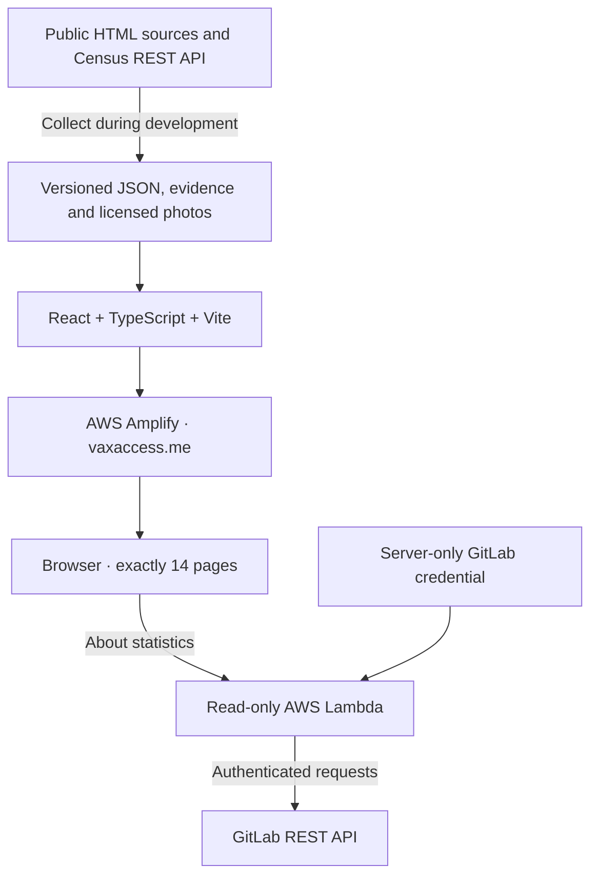

# VaxAccess — Phase I Design

**Final design · September 28, 2026**

This is the standalone implementation specification for VaxAccess. It incorporates the team's approved decisions and the supplied eight-page CS 373 IDB1 specification. A new implementer must be able to build the project from this document without the preceding conversation. This document contains instructions, contracts and diagrams, not application code.

The design is final; implementation, external account setup and submission have not been performed. The team will manually supply member biographies, portraits and actual responsibilities during implementation. Account identifiers, credentials, the Postman publication URL and deployment outputs are also implementation inputs. Their handling is specified below; they do not require reopening the design.

## 1. The Problem

VaxAccess helps uninsured and underinsured people understand vaccination options and find resources in Austin and Travis County. Its secondary purpose is to show how community members can support vaccine access. The three models are **Site**, **Vaccine** and **VolunteerOpportunity**.

The primary journey is Home → Sites or Vaccines → details → the relevant provider's external resource. The secondary journey is Home → Volunteer opportunities → details → the organizer's external information. Phase I is an informational directory; it does not book appointments, accept payments, register volunteers or collect health information.

### Scope and priorities

- Deliver **exactly 14 content pages**, using the route inventory in Section 4.1.
- Include three real records per model. A Vaccine is a category, not a branded product.
- Support ongoing volunteer programs and dated events in the data model. Historical examples are explicitly permitted in Phase I.
- Every detail record connects to at least one instance of each other model. Volunteer-to-vaccine connections must be explicit and sourced.
- Bundle domain records as JSON. No database or live domain backend is required in Phase I.
- Implement working filtering and sorting for all five card attributes.
- Integrate the GitLab API in Phase I for automated About-page statistics.
- Use real photography with truthful captions and attribution. Do not generate AI images.
- Use English. Keep interface strings centralized for later localization.
- Keep coordinates and reusable data access contracts for future expansion. Distance search, additional languages, accounts, bookings, internal donations, user submissions and administration are outside Phase I.
- Prefer resources for people seeking vaccines over ways to volunteer.

The selected historical records demonstrate community vaccination work; they are not a current appointment directory. Home and the Sites listing must prominently link to [Austin Public Health's current immunization resources](https://www.austintexas.gov/health/programs/immunizations). Each historical Site and opportunity must display its dated context. Never convert an old event into a claim of current availability.

### Completion standard

The finished site must have all 14 pages, nine connected records, nine distinct card photographs, required embedded media, functional controls, real GitLab statistics, complete team profiles, source/tool credits, the published Postman link and HTTPS at **vaxaccess.me**. A local build with missing credentials or team-supplied content is useful development output but is not submission-ready.

## 2. The Technical Plan

### Stack and service boundaries

| Area | Required choice |
| --- | --- |
| Frontend | React, TypeScript, Vite, React Router |
| Styling | Bootstrap plus project CSS using the supplied palette |
| Domain storage | Versioned JSON imported by the frontend |
| Frontend hosting | AWS Amplify Hosting |
| Statistics service | A read-only TypeScript AWS Lambda exposed through a function URL |
| Statistics upstream | GitLab REST API for the fixed project |
| Unit/component tests | Vitest and React Testing Library |
| Browser acceptance tests | Playwright |
| API design | Postman collection and published documentation |
| Repository | https://gitlab.com/nifemisoyemi/cs373-fall-2026-18 |
| Production domain | https://vaxaccess.me |

At implementation time, install mutually compatible stable dependencies and commit the exact npm lockfile. Record the selected Node LTS version in `.nvmrc` and the package engine requirement; use that same version locally, in CI and for the supported Lambda runtime. Do not use floating dependency versions in CI.

### Architecture diagram

The browser loads bundled domain records and calls Lambda only for statistics. Lambda never accepts an arbitrary repository or upstream URL. No GitLab token belongs in browser code, public configuration, a Postman export or committed files.

The Postman collection specifies six future domain endpoints. Those endpoints are documented and illustrated in Phase I; they are not a dependency of the static frontend. The statistics endpoint is operational in Phase I.

### Data and extensibility

Page components call the catalog service rather than importing fixtures directly. The catalog service resolves IDs, derives related records and produces the exact display strings used for filtering and sorting. Its interface remains the boundary for a future API implementation.

Use one relationship file containing three edge collections: Site–Vaccine, Opportunity–Site and Opportunity–Vaccine. Store each edge once and derive reverse navigation. Sources and media also have stable IDs. Do not duplicate linked records inside other records.

There must be at least three programmatically collectable content sources. The selected source plan uses UT Austin, Austin Public Health/City of Austin, CDC and the **U.S. Census Geocoder REST API**. Census responses supply geographic attributes of the Site records. GitLab statistics alone do not satisfy domain-data collection.

### Operational behavior

Static pages remain usable if GitLab is unavailable. About independently displays loading, current, stale or unavailable statistics. Missing data never becomes a fabricated zero.

Freeze deployed code and domain fixtures after submission until grading. As explicitly directed by the team, live GitLab counts continue refreshing during that freeze. This is the team's interpretation of freeze behavior; do not describe it as an additional instructor ruling.

## 3. Alternatives

| Selected | Alternative not selected | Reason |
| --- | --- | --- |
| Static JSON behind a catalog service | Phase I database and full application server | Meets the hardcoded scope while preserving a future data-access boundary |
| Amplify and a small statistics Lambda | Browser-held GitLab token | Protects credentials and centralizes pagination, attribution and caching |
| Vaccine categories | Separate pages for every branded product | Matches the approved model meaning and three-record scope |
| Explicit, dated relationship evidence | Inferring vaccine support from an organization's general mission | Keeps cross-model links truthful |
| Clearly labeled historical examples | Presenting old clinics or roles as available now | Preserves real examples without misleading visitors |
| One static hero photograph | Slideshow | Provides imagery without additional controls or motion |
| Redirects into existing pages | A separate error/not-found page | Preserves exactly 14 content pages |
| Centralized English strings | Multilingual UI in Phase I | Supports later localization without expanding this phase |
| Live statistics with dated failure states | Manually entered or frozen counters | Meets the approved GitLab integration |

## 4. Detailed Implementation

### 4.1 Route map and exact page count

The three slugs in each detail row are the only Phase I instance URLs.

| URL | Page file | Count |
| --- | --- | ---: |
| `/` | `src/pages/HomePage.tsx` | 1 |
| `/sites` | `src/pages/SitesPage.tsx` | 1 |
| `/vaccines` | `src/pages/VaccinesPage.tsx` | 1 |
| `/opportunities` | `src/pages/OpportunitiesPage.tsx` | 1 |
| `/sites/travis-county-exposition-center`; `/sites/montopolis-recreation-center`; `/sites/austin-first-spanish-sda` | `src/pages/SiteDetailPage.tsx` | 3 |
| `/vaccines/influenza`; `/vaccines/covid-19`; `/vaccines/mpox` | `src/pages/VaccineDetailPage.tsx` | 3 |
| `/opportunities/ut-flu-expo-2020`; `/opportunities/aph-mpox-montopolis-2024`; `/opportunities/vamos-rundberg-2021` | `src/pages/OpportunityDetailPage.tsx` | 3 |
| `/about` | `src/pages/AboutPage.tsx` | 1 |
| **Total** | **Eight reusable page components** | **14** |

Unknown paths redirect to Home with history replacement. Unknown instance IDs redirect to their model listing with a visible explanation. These are redirects and page states, not additional content pages. No standalone search, sources, credits, contact, signup, privacy or 404 page is created.

Amplify must rewrite application deep links to `index.html` with HTTP 200 while serving existing static assets normally. Test direct navigation and refresh on all nine detail URLs.

### 4.2 Layout, content and interaction

**Shared shell.** Use a top navbar with VaxAccess linking to Home and links labeled Home, Sites, Vaccines, Volunteer opportunities and About. Indicate the active section. Collapse navigation on smaller screens with an accessible menu button. Include a skip-to-content link, one main landmark and one page-level heading. Footer links reuse existing routes and the repository; credits remain within About and media captions.

**Home.** In order: global navigation; an introduction beside a real hero photograph; a prominent current-resource link; primary resource navigation to Sites and Vaccines; a visually secondary volunteering section; footer. Heading: “Vaccination resources for Austin communities.” Intro: “Explore vaccine information and community vaccination resources, with a focus on people who are uninsured or underinsured.” Explain that Phase I includes historical examples. Actions: “Browse vaccination sites,” “Explore vaccines,” and “Explore volunteer opportunities.” The first two receive stronger visual emphasis.

**Listings.** Show the model title, a short explanation, total records and pagination information, filter/sort controls, result count and card grid. Initial text must communicate **3 instances · 1 page · Page 1 of 1**. Cards contain a unique photo, linked title, all five labeled attributes and an explicit detail link. Historical badges are additional to the five fields. Use the same cards in related-record sections.

**Site details.** Show historical status prominently, then cost/payment, population/eligibility, appointment method, address/map, vaccine cards, opportunity cards and sources. Historical details describe the documented event, not the building's current services. Provide “Find current vaccination services” linking to APH. A venue's normal operating hours are not vaccination hours.

**Vaccine details.** Explain the disease category, population, type, administration and qualified schedule summary. Follow with the photograph/video, related historical Sites and opportunities, and official medical sources. Say “Sites with documented vaccination activity,” not “Available today.” Include a brief note that individual eligibility and timing must be confirmed with a qualified provider.

**Opportunity details.** Show activity, organization, time/date, requirements, status, media, related Sites and vaccines, source links and organizer information. Completed/archived examples display “Past activity — not accepting signups through this listing.” Replace an application CTA with “View historical source” and “Explore organizer information.” Do not reactivate an old signup form. The reusable template must also support a future ongoing role with no end date.

**About.** In order: purpose and intended users; five team cards; aggregate statistics and their definitions/timestamps; data sources; tools and how each is used; repository and published Postman documentation links. Include all media credits here as well as next to images. Display Jia's Phase I leader role. Member content is managed in JSON, not embedded in the page component.

**Responsive presentation.** Use Bootstrap's mobile-first grid: one card per row initially, two at its medium breakpoint and three at its large breakpoint. Use a centered responsive container, consistent gutters, readable paragraph widths and system sans-serif typography. Stack detail columns on mobile. Card attributes wrap rather than truncate. Use a consistent landscape photo frame with an accessible full-image/source link; preserve meaningful image content.

**Accessibility and media states.** Use native labels and controls, visible keyboard focus, semantic heading order, alt text, descriptive embed titles and non-color status cues. Maintain readable contrast; never place pale accent text on pale surfaces. Images include dimensions and lazy loading below the first screen. Videos do not autoplay. If an embed fails, retain its caption and external link; a broken embed is a release defect, not a substitute for the second required media type. Support keyboard navigation and avoid horizontal page overflow.

### 4.3 Visual system

Use the supplied palette exactly. The principal roles are porcelain-50 background, ink-black-900 text, yale-blue-700 primary buttons, powder-blue accents and dry-sage-100 support sections. Use white cards, subtle borders, rounded corners and restrained shadows. Primary button text is white; links use a dark blue that remains readable against their surface. Keep focus, hover and disabled states distinguishable.

| Shade | ink-black | yale-blue | powder-blue | porcelain | dry-sage |
| --- | --- | --- | --- | --- | --- |
| 50 | #edf3f8 | #eef2f6 | #eaf1fa | #f1f5f0 | #f5f7ee |
| 100 | #dbe7f0 | #dde4ee | #d6e3f5 | #e3eae1 | #eaeedd |
| 200 | #b6cee2 | #bcc9dc | #adc8eb | #c6d6c2 | #d6deba |
| 300 | #92b6d3 | #9aaecb | #84ace1 | #aac1a4 | #c1cd98 |
| 400 | #6d9dc5 | #7894ba | #5b91d7 | #8dac86 | #acbd75 |
| 500 | #4985b6 | #5779a8 | #3275cd | #719867 | #97ac53 |
| 600 | #3a6a92 | #456187 | #285ea4 | #5a7953 | #798a42 |
| 700 | #2c506d | #344865 | #1e467b | #445b3e | #5b6732 |
| 800 | #1d3549 | #233043 | #142f52 | #2d3d29 | #3d4521 |
| 900 | #0f1b24 | #111822 | #0a1729 | #171e15 | #1e2211 |
| 950 | #0a131a | #0c1118 | #07101d | #10150e | #15180c |

Store all 55 supplied colors as CSS custom properties in `tokens.css`. Semantic variables reference these tokens. Do not use color names as an assumption that every shade has suitable contrast.

### 4.4 Card fields, filters and sorting

Title and photo do not count toward the five attributes.

| Model | Display label → field key |
| --- | --- |
| Site | Address → `address`; Population served → `populationServed`; Cost/payment → `costPolicy`; Appointment method → `appointmentMethod`; Offered vaccines → `vaccines` |
| Vaccine | Diseases prevented → `diseasesPrevented`; Intended age group → `ageGroup`; Vaccine type → `vaccineType`; Administration → `administrationMethod`; Dose/schedule → `scheduleSummary` |
| VolunteerOpportunity | Organization → `organization`; Activity → `activityType`; Time commitment → `timeCommitment`; Requirements → `requirements`; Supported vaccines → `vaccines` |

The collapsible filter panel has one text input for each field. Trim leading/trailing query whitespace and compare case-insensitive substrings against the same string displayed on the card. All populated filters combine with AND. Arrays become the same comma-separated text used for display. Empty filters match every record.

The sort selector contains all five field keys and a direction selector contains A–Z and Z–A. Initial ordering is title A–Z. Use English locale-aware text comparison, then title, then ID as stable tie-breakers. Cost and dose fields sort alphabetically; they are not numerical rankings.

Filtering precedes sorting. Show “Showing N of 3 sites/vaccines/opportunities”; retain the total catalog page count. Zero matches show an inline message and Clear filters. Clear filters empties all filter inputs; sort remains as selected. No results are hidden behind additional pages. There is no Phase I distance filter or global search.

Keep control state in the current listing component. Navigating away and returning initializes the controls again. Preserve ordinary browser navigation and route history.

### 4.5 Data contracts

Implement these contracts as TypeScript types and JSON validation. Required strings must be nonempty. IDs are stable lowercase slugs. Dates use ISO format; public date formatting uses English and America/Chicago for local events.

| Contract | Required fields and meaning |
| --- | --- |
| Common record | `id`, `name`, `summary`, `descriptionParagraphs`, `photoId`, `sourceIds`, `fieldSources`, `externalLinks`, `verifiedOn` |
| Site | Common fields; `address` object (street, city, state, postalCode); `populationServed`, `costPolicy`, `appointmentMethod`; `latitude`/`longitude`; `serviceContext` = historical or current; `contextLabel` |
| Vaccine | Common fields; `diseasesPrevented` string array; `ageGroup`, `vaccineType`, `administrationMethod`, `scheduleSummary`; `videoId` |
| VolunteerOpportunity | Common fields; `organization`, `activityType`, `timeCommitment`, `requirements` string array; `kind` = event or ongoing; `status` = upcoming, ongoing or past; nullable `startDate`/`endDate`; `datePrecision` = day, month, year or unspecified; `dateLabel`; nullable `applicationUrl`; `organizerUrl` |
| Relationship edge | Source and target IDs for its typed collection; `sourceIds`; `context` explaining the documented connection; `historical` boolean; nullable dates with precision |
| Source | `id`, `title`, `publisher`, `url`, `kind` = html or rest; `retrievedAt`; nullable `publishedAt`; `rawPath`; `usedFor` |
| Photograph | `id`, `localPath`, `sourcePageUrl`, `originalUrl`, `creator`, `licenseName`, `licenseUrl`, `caption`, `alt`, `changes`, `width`, `height` |
| Video | `id`, `title`, `publisher`, `watchUrl`, `embedUrl`, `caption` |
| Team member | `name`, `username`, `phaseRole`; nullable `bio` and `photoId`; `responsibilities` array |
| External link | `label` and absolute HTTPS `url` |
| Field provenance | Map from a factual field key to one or more source IDs |

Related `vaccines`, `sites` and `opportunities` are derived from relationship edges, not stored as duplicated arrays in model fixtures. Unknown historical facts display “Not stated in the historical source.” That is a documented absence, not an invitation to invent a price, eligibility rule, shift duration or qualification.

Coordinates are required in release data and must come from the collection process. During initial local development only, null coordinates may render the address and external map link. Release validation must reject that state.

Dates describe what the evidence establishes. An article's publication date is not an event's start or end date. For an archived program with no documented end, retain null dates and a truthful year-level label. Phase I status is explicit in fixture data and does not change automatically with the browser clock.

Descriptions must provide useful original prose: context, access or participation facts, temporal limitations and source links. Avoid padding or copying source articles.

### 4.6 Selected nine records and relationship matrix

These are the selected fixtures, not a menu of alternatives. Populate the defined fields from these values and the linked sources in Section 4.7.

**Sites**

| ID / name | Address | Population / cost / appointment fields | Vaccine context |
| --- | --- | --- | --- |
| `travis-county-exposition-center` — Travis County Exposition Center | 7311 Decker Lane, Austin, TX 78724 | Community vaccination participants; detailed patient criteria, cost and appointment process are not stated in the selected volunteer notice | Influenza activity on November 7, 2020 |
| `montopolis-recreation-center` — Montopolis Recreation and Community Center | 1200 Montopolis Drive, Austin, TX 78741 | Community members seeking mpox vaccination; free at the documented event; appointment requirements not established by the event report | Mpox clinic on August 24, 2024 |
| `austin-first-spanish-sda` — Austin First Spanish SDA Church | 100 W Rundberg Lane, Austin, TX 78753 | Underserved Austin-area residents reached through community outreach; price and formal appointment requirements not stated in the selected report | COVID-19 outreach documented in 2021 |

All three Site records have historical service context. Do not infer that any venue currently offers the linked vaccine, or that insurance criteria from an unrelated program apply to it.

**Vaccine categories**

| ID / name | Diseases / intended population | Type / administration / schedule summary |
| --- | --- | --- |
| `influenza` — Influenza (flu) | Influenza; generally people aged six months and older, with product-specific restrictions | Inactivated, recombinant or live attenuated, depending on product; injection or eligible nasal-spray formulation; seasonal vaccination, with age/history-dependent dosing |
| `covid-19` — COVID-19 | COVID-19; eligibility depends on age, product, risk and current guidance | Product-dependent, including mRNA and protein-based approaches; injection; timing and number of doses depend on current guidance and individual history |
| `mpox` — Mpox | Mpox; people meeting exposure/risk criteria; age-specific administration requires provider review | The documented event used JYNNEOS, a live nonreplicating vaccine; subcutaneous or eligible intradermal administration; the cited CDC guidance describes two doses four weeks apart |

Keep these as categories even when explaining a product used at an event. For COVID-19, the CDC consumer page reviewed for this design flags newer seasonal clinical guidance: link through to that guidance and do not publish an obsolete fixed seasonal schedule. Clinical content must be checked against the cited official pages when fixtures are collected.

**Volunteer opportunities**

| ID / title | Organization and activity | Time / requirements / status |
| --- | --- | --- |
| `ut-flu-expo-2020` — UT nursing flu-vaccination support at the Expo Center | UT Austin School of Nursing; supervised vaccination and patient education | November 7, 2020; shift duration not stated; nursing students supervised by faculty; past event |
| `aph-mpox-montopolis-2024` — Austin–Travis County MRC mpox-clinic support | Austin–Travis County Medical Reserve Corps / Austin Public Health; vaccination-clinic support | August 24, 2024; duration and event-specific volunteer qualifications not stated in the event report; past event |
| `vamos-rundberg-2021` — VAMOS community COVID-19 outreach at Rundberg | UT Austin School of Nursing / VAMOS with community volunteers; vaccination outreach and support | Wednesday outreach documented in 2021; exact shift and event-specific prerequisites not stated; archived ongoing-program example, status past |

For the third record, `kind` is ongoing, `status` is past, `datePrecision` is year and `dateLabel` is “Historical outreach documented in 2021.” Do not invent a last operating date. For the two dated events, start and end dates equal the documented calendar date with day precision; do not invent start/end times.

The source confirms volunteer participation in the VAMOS program and outreach at the church. Describe the opportunity as support for that outreach; do not claim a specific person or every listed program role was assigned to that particular location. The MRC's present recruitment information is a separate organizer link, not proof of the historical event's admission requirements.

| Site | Vaccine | Opportunity | Evidence |
| --- | --- | --- | --- |
| Travis County Exposition Center | Influenza | UT flu support, 2020 | UT volunteer notice, S1 |
| Montopolis Recreation Center | Mpox | MRC mpox support, 2024 | Contemporaneous event report S2, corroborating APH material S3 |
| Austin First Spanish SDA Church | COVID-19 | VAMOS Rundberg outreach, 2021 | UT program report S4 |

Create the three typed edges for each row: Site–Vaccine, Opportunity–Site and Opportunity–Vaccine. This produces nine canonical edges and gives every record a connection to both other models. Do not create a complete cross-product between the three models.

### 4.7 Sources and programmatic collection

| ID | Source | Use |
| --- | --- | --- |
| S1 | [UT flu-volunteer notice](https://sites.utexas.edu/sonstudentservices/2020/10/30/volunteer-opportunity-flu-vaccination/) | Flu event, date, location and participation |
| S2 | [FOX 7's August 24, 2024 event report](https://www.fox7austin.com/news/free-mpox-monkeypox-vaccines-austin-public-health) | Mpox event, venue, MRC participation and event price |
| S3 | [APH presentation preserved in the city commission archive](https://bandc.crccheck.com/lesbian-gay-bisexual-transgender-and-queer-quality-life-advisory-commission/431865-backup/) | Corroborating planned MRC/Montopolis vaccination connection |
| S4 | [UT nursing report on VAMOS](https://nursing.utexas.edu/news/honesto-transparente-y-empatico-mobile-vaccination-clinics-reach-austin-area-hispanic) | Community outreach, church location and volunteer participation |
| S5 | [Travis County facility information](https://www.traviscountytx.gov/exposition-center/rental) | Expo Center address |
| S6 | [City of Austin Montopolis facility page](https://www.austintexas.gov/parks/locations/montopolis-recreation-and-community-center) | Montopolis address; distinguish facility hours from clinics |
| S7 | [Austin Spanish First SDA Church](https://austinspanishfirsttx.adventistchurch.org/) | Church address |
| S8 | [CDC flu basics](https://www.cdc.gov/flu/vaccines/index.html) and [vaccine formulations](https://www.cdc.gov/flu/vaccines/keyfacts.html) | Influenza category fields |
| S9 | [CDC COVID-19 vaccination](https://www.cdc.gov/covid/vaccines/stay-up-to-date.html), [vaccine types](https://www.cdc.gov/covid/vaccines/how-they-work.html) and linked current clinical guidance | COVID-19 category fields |
| S10 | [CDC mpox vaccination](https://www.cdc.gov/monkeypox/vaccines/) and [JYNNEOS type](https://www.cdc.gov/mmwr/volumes/74/wr/mm7422a3.htm) | Mpox category fields |
| S11 | [Census Geocoder API documentation](https://geocoding.geo.census.gov/geocoder/Geocoding_Services_API.html) | REST collection of Site geographic attributes |
| S12 | [APH immunization resources](https://www.austintexas.gov/health/programs/immunizations) | Current-resource link and general educational video |
| S13 | [Austin–Travis County MRC](https://www.austintexas.gov/health/austin-travis-county-medical-reserve-corps) and [UT MRC](https://sites.utexas.edu/utmrc/) | Organizer information; no promise of an available shift |

Create `scripts/collect-data.ts` to fetch the selected HTML sources and the Census REST endpoint. Extract bounded, relevant content into source evidence; write original summaries rather than copying articles. Store request URL, retrieval time, response status, source publication date when known and fields derived. Keep compact evidence excerpts and the actual JSON responses under `data/raw/`; exclude personal contact data unrelated to the project.

For each selected Site, request `https://geocoding.geo.census.gov/geocoder/locations/onelineaddress` using its full address, `benchmark=Public_AR_Current` and `format=json`. Read `result.addressMatches`. Accept only a match consistent with the source address; use `coordinates.x` as longitude and `coordinates.y` as latitude. Store the matched address and benchmark with the raw response. Do not guess coordinates or accept an unrelated first match. If one-line matching fails, use the documented structured-address endpoint with the same source address.

Collection is an implementation task, not a claimed completed API transaction in this design. Release requires an actual successful REST response contributing to the bundled domain records, plus evidence from at least three programmatically accessed sources. A blocked response or a link to API documentation does not satisfy collection.

After collection, commit the curated fixtures and provenance. Normal builds must use those snapshots and must not scrape the web. Source changes must never silently replace fixtures during a build or deployment freeze. Do not use the previously investigated Austin provider dataset to invent historical venue participation; the selected REST enrichment is Census geocoding.

### 4.8 Photography and embedded media

Download the following selected originals or provider-generated photographic derivatives during implementation. Save local optimized files using the target names below. Preserve the source-page and original-download URLs in `media.json`. “Illustrative” captions must appear on both cards and detail media; do not imply a stock photograph depicts the named Austin event.

| Assignment / local filename under `public/images/` | Selected source | Credit / license | Caption requirement |
| --- | --- | --- | --- |
| Expo Site — `site-expo.jpg` | [Stage in the Banquet Hall](https://commons.wikimedia.org/wiki/File:Stage_in_the_Banquet_Hall.jpg) | jonl; CC BY-SA 2.0 | Banquet-hall stage at the Travis County Exposition Center; not a photo of the vaccination event. Omit the unreliable capture date in the source metadata. |
| Montopolis Site — `site-montopolis.jpg` | [Colorado river montopolis](https://commons.wikimedia.org/wiki/File:Colorado_river_montopolis.jpg) | Larry D. Moore; CC BY 4.0 | Colorado River viewed from Montopolis Bridge; neighborhood context, not the recreation-center building. |
| Rundberg Site — `site-rundberg.jpg` | [COVID-19 Vaccination, OC-LSC-0001](https://commons.wikimedia.org/wiki/File:COVID-19_Vaccination_(20210318-OC-LSC-0001).jpg) | USDA / Lance Cheung; U.S. public domain | Illustrative COVID-19 vaccination in San Antonio; not the Austin church event. Omit the conflicting capture-date metadata. |
| Influenza — `vaccine-influenza.jpg` | [Influenza vaccine (2021) A](https://commons.wikimedia.org/wiki/File:Influenza_vaccine_(2021)_A.jpg) | Rodrigo Chagas / Prefeitura de Pelotas; public-domain designation on source | Influenza-vaccination campaign photograph from Pelotas, Brazil; illustrative. |
| COVID-19 — `vaccine-covid-19.jpg` | [Moderna COVID-19 vaccine](https://commons.wikimedia.org/wiki/File:Moderna_COVID-19_vaccine.jpg) | U.S. Air Force / Anna Nolte; U.S. public domain | Historical Moderna vaccine vials at Kadena Air Base; product illustration, not a current formulation or endorsement. |
| Mpox — `vaccine-mpox.jpg` | [Monkeypox Virus, 52131590463](https://commons.wikimedia.org/wiki/File:Monkeypox_Virus_(52131590463).jpg) | NIAID; CC BY 2.0 | Colorized electron micrograph of mpox virus particles; not a vaccine image. |
| UT flu opportunity — `opportunity-flu.jpg` | [Influenza vaccine, N-HD638-013](https://commons.wikimedia.org/wiki/File:Influenza_vaccine_150929-N-HD638-013.jpg) | U.S. Navy; U.S. public domain; retain the linked DVIDS credit | Illustrative influenza vaccination in San Diego; not the UT event. |
| MRC mpox opportunity — `opportunity-mpox.jpg` | [Austin Skyline from Montopolis Bridge](https://commons.wikimedia.org/wiki/File:Austin_Skyline_from_Montopolis_Bridge.jpg) | Scott218; CC BY-SA 4.0 | Austin skyline viewed from Montopolis Bridge; community context, not event documentation. |
| VAMOS opportunity — `opportunity-covid-19.jpg` | [COVID-19 Vaccination, OC-LSC-0003](https://commons.wikimedia.org/wiki/File:COVID-19_Vaccination_(20210318-OC-LSC-0003).jpg) | USDA / Lance Cheung; U.S. public domain | A separate illustrative vaccination photograph from San Antonio; not VAMOS outreach. |

The hero reuses the Austin skyline photograph, with its actual caption and credit. Each of the nine cards still has a distinct source photograph. Team portraits are separate team-provided assets.

Credit links must include the photographer or organization, source page and license. Record resizing/cropping in `changes`; preserve applicable share-alike licensing for modified images. Source dates with inconsistent metadata must not become invented captions. No source's presence on the web grants automatic reuse permission; use the licenses recorded above.

**Site and opportunity media:** each of these six details has its assigned photo plus an embedded OpenStreetMap centered on the linked Site's collected coordinates. Use OpenStreetMap's export/embed format, preserving provider attribution, with a marker and a small surrounding bounding box. Show the text address and external map link outside the iframe. Label historical maps as event-location context.

**Vaccine media:** each of these three details has its assigned photo plus APH's English educational video, [Getting Immunized From A to Z](https://www.youtube.com/watch?v=-P_lgZFUHTs). Embed its video ID `-P_lgZFUHTs` through YouTube's privacy-enhanced embed host. Caption it as general guidance on APH appointments and visits; it is not vaccine-specific clinical guidance or proof of stock. The same video may appear on all three Vaccine pages; the unique-image requirement applies to card photographs.

This assigns **photo + map** to six detail pages and **photo + video** to three. External source links and text alone do not count as the second embedded media type. Verify image decoding, licenses, embed playback and map markers before release.

### 4.9 Team profiles and GitLab statistics

| Name | GitLab username | Fixed phase role |
| --- | --- | --- |
| Jia Luthra | `jiakl` | Phase I leader |
| Alex Bui | `atb2923` | Team member |
| Enzo Sagun | `j.enzosagun` | Team member |
| Nifemi Soyemi | `nifemisoyemi` | Team member |
| Luke Yan | `lukeyawn` | Team member |

The team will fill biographies, portraits and major responsibilities manually, including responsibilities after completing issues. All may describe development work when truthful; do not invent distinct assignments. During development, use a neutral initials placeholder and explicit missing-profile text. Before submission, replace every placeholder with the required real information. A placeholder graphic is not a substitute for the rubric's member photo.

**Metric definitions**

| Metric | Counting rule |
| --- | --- |
| Commits | Unique commit SHAs reachable from the actual default branch, including merges; attribute to the recorded author |
| Issues | Open and closed project issues created by the member; use author identity, not assignee |
| Unit tests | Distinct executed unit cases reported by the latest successful default-branch pipeline; count parameterized cases separately; report skipped cases separately |
| Totals | Project-wide counts using the same definitions; explain unattributed/non-roster contributions separately so totals reconcile |

Do not count merge requests as issues, assertions as tests, browser acceptance cases as unit tests, or commit appearances more than once. Do not sum per-member numbers and silently omit other contributors from a project total.

**GitLab acquisition**

1. Resolve `nifemisoyemi/cs373-fall-2026-18` through `GET /api/v4/projects/:urlEncodedPath`. Read the numeric ID and default branch from the response.
2. Resolve the exact roster usernames to GitLab user IDs. Maintain verified commit-author email/name aliases in the server-only contributor mapping. Do not infer identity from approximate display-name matches.
3. Read `/projects/:id/repository/commits` with `ref_name` set to the discovered default branch. Do not use all-branches mode.
4. Read `/projects/:id/issues` with `scope=all` and `state=all`; aggregate by author ID.
5. Find the latest successful default-branch pipeline through `/projects/:id/pipelines`, sorted by descending pipeline ID. Fetch its `/test_report`.
6. Exhaust every paginated response using GitLab's continuation headers. Never rely on a total-count header being present. If any required page fails, that metric is incomplete and must not be presented as a complete total.

**Unit-test attribution.** Maintain one roster username for every unit-test file in `tests/test-owners.json`. Assign owners as the team actually develops the tests. CI emits JUnit XML and normalizes each test case's classname to include its repository-relative file path and suite name. The ownership script also produces `unit-test-owners.json` as a CI artifact. Lambda downloads that artifact from the same pipeline's `unit` job and maps the report's file prefix to its owner. This avoids using an ownership map from a different commit. Missing or malformed ownership makes the per-member unit metric unavailable; do not guess.

The ownership artifact contains the pipeline ID, commit SHA and an `owners` map from relative unit-test file paths to roster usernames. Validate its pipeline and SHA against the selected report. Publish only the unit job's normalized JUnit into the pipeline test report; Playwright retains its own acceptance artifacts and does not contribute unit counts.

Use a normalized identity of file path + suite name + test name to deduplicate report cases. Require unique names within each suite, including parameter labels. Mark missing reports as unavailable. A real, successfully retrieved zero-case report is distinct from a missing report.

**Service response.** Return JSON containing `projectPath`, `generatedAt`, `defaultBranch`, nullable `pipeline` (ID, SHA, URL), `members`, `totals` and `unattributed`. Each metric group has `status` = current, stale or unavailable; nullable `asOf`; nullable `value`; and nullable safe `message`. Unit-test groups additionally carry `skipped`. A stale value retains its original timestamp. Include the metric definitions in About text.

The `members` array contains exactly the five roster entries, each with `name`, `username`, `commits`, `issues` and `unitTests`. `totals` and `unattributed` use those same three metric keys. Values are nonnegative integers when available and null when unavailable. All timestamps are ISO UTC strings. The pipeline metadata always belongs to the displayed unit-test snapshot, including when that snapshot is stale. Return HTTP 200 for a valid statistics envelope even when upstream metric groups are unavailable; malformed methods/paths and service-level failures use appropriate error statuses. The client must also handle a non-JSON network/service error.

**Caching and errors.** Keep successful metric snapshots in the Lambda execution environment for five minutes. This is an in-memory cache, not durable storage: cold starts may have no previous value. Coalesce concurrent refreshes within an instance. On upstream failure, return a clearly stale prior value when one exists; otherwise return unavailable. Do not claim a globally shared cache or guaranteed stale data after a cold start.

The browser requests statistics on About entry, then at five-minute intervals while About is visible, and cancels timers/requests on unmount. Show loading before the first response and offer a Retry action after failure. Preserve usable static About content throughout.

Lambda accepts GET for the statistics resource and OPTIONS for CORS; reject other methods and unknown paths. Its function URL exposes only this fixed read-only output. Configure CORS for the exact production origin and explicit development/preview origins used by the team; CORS is not authentication. Set bounded request timeouts, obey GitLab rate-limit responses and return safe unavailable states. Never log tokens or return raw credential-bearing upstream errors.

Use a least-privilege GitLab read credential in Lambda's server environment. Public frontend variables contain only the endpoint URL. Verify actual repository visibility, API permission, pipeline access and test-artifact access during setup; this design does not claim those accounts have already been configured.

Technical references: [GitLab REST/pagination](https://docs.gitlab.com/api/rest/), [commits](https://docs.gitlab.com/api/commits/), [issues](https://docs.gitlab.com/api/issues/), [pipelines/test reports](https://docs.gitlab.com/api/pipelines/), [JUnit reports](https://docs.gitlab.com/ci/testing/unit_test_reports/) and [job artifacts](https://docs.gitlab.com/api/job_artifacts/).

### 4.10 Postman domain API contract

Create and publish `VaxAccess Phase I API` with six requests. Set collection variables `baseUrl`, `siteId`, `vaccineId` and `opportunityId`. Use the selected fixture IDs in saved examples. Describe the collection explicitly as the future domain API design; do not label an undeployed endpoint as live.

| Method and path | Result |
| --- | --- |
| GET `/api/v1/sites` | Paginated Site collection |
| GET `/api/v1/sites/{id}` | One Site |
| GET `/api/v1/vaccines` | Paginated Vaccine collection |
| GET `/api/v1/vaccines/{id}` | One Vaccine |
| GET `/api/v1/opportunities` | Paginated opportunity collection |
| GET `/api/v1/opportunities/{id}` | One opportunity |

**List query contract:** `page` is an integer ≥1, default 1; `pageSize` is 1–100, default 3. Each field from Section 4.4 has a `filter[fieldKey]` query parameter. `sort` is one of the five keys or `name`, default name; `order` is asc or desc, default asc. Use the same display-text matching and stable sorting semantics as the frontend. Reject unknown filters/sort fields, duplicate scalar parameters and invalid pagination values with HTTP 400.

**Response contract:** list responses contain `data` and `meta`. Meta includes page, pageSize, totalItems, filteredItems and totalPages. Calculate totalPages from filteredItems; an empty filtered collection has totalPages 0. A valid page beyond the available results returns HTTP 200 with empty data and unchanged counts. This API metadata does not add pagination routes to the Phase I website.

Detail responses contain `data` using the model contract, plus derived `relationships` with related IDs grouped by model. Both list and detail envelopes additionally include `included.sources` and `included.media`, containing the source and media objects referenced by their returned records. Related records are identified by ID and retrieved through the six specified endpoints. Clients must not scrape rendered text to reconstruct relationships.

Errors contain an `error` object with `code`, `message` and optional `details`. Use 400 for invalid query syntax/values, 404 for unknown record IDs and a documented 500 example for server failure. A valid empty list is 200.

Save list examples for the full three-record result, filtering, reverse sorting, pageSize 1 and zero matches. Save detail examples for all nine IDs and missing IDs. Include error examples and schema/assertion tests covering counts, required fields and relationships. Saved examples are the Phase I demonstration; deploying a domain API or mock server is not part of this scope. Publish the public documentation URL and insert it into About before release.

### 4.11 File creation map

All paths are relative to the repository root. No file in this table creates an extra content page.

| Files | Required responsibility |
| --- | --- |
| `package.json`, `package-lock.json`, `.nvmrc` | Dependencies, runtime and named build/test/collection tasks |
| `tsconfig.json`, `tsconfig.app.json`, `tsconfig.node.json`, `vite.config.ts`, `index.html` | Strict TypeScript, Vite, SPA entry |
| `eslint.config.js`, `vitest.config.ts`, `playwright.config.ts` | Lint, unit and acceptance configuration |
| `src/main.tsx`, `src/App.tsx`, `src/routes.tsx` | Mount app, shared shell, approved routes and redirects |
| Eight `src/pages/` files in Section 4.1 | Page composition and content hierarchy |
| `src/components/Navbar.tsx`, `Footer.tsx`, `PageLayout.tsx` | Shared shell, responsive navigation, landmarks |
| `src/components/ModelCard.tsx`, `ListingControls.tsx`, `RelatedCards.tsx` | Reused five-attribute cards, filters, sort and counts |
| `src/components/MediaBlock.tsx`, `SourceList.tsx`, `StatusBadge.tsx` | Captioned images/embeds, provenance and historical state |
| `src/components/TeamCard.tsx`, `StatsPanel.tsx` | Manual profile content and live metric states |
| `src/types/domain.ts`, `src/types/stats.ts` | Contracts from Sections 4.5 and 4.9 |
| `src/data/sites.json`, `vaccines.json`, `opportunities.json` | Exactly three records each |
| `src/data/relationships.json`, `sources.json`, `media.json`, `team.json` | Canonical edges, provenance, assets and roster |
| `src/services/catalog.ts`, `listing.ts`, `statsClient.ts` | Data access, shared filter/sort functions, Lambda client |
| `src/config/site.ts`, `src/content/en.ts` | Public links/environment values and English UI copy |
| `src/styles/tokens.css`, `global.css`, `components.css` | Exact palette, Bootstrap integration and responsive styling |
| `public/images/` | Nine selected photos and team-supplied portraits |
| `server/stats/handler.ts`, `gitlabClient.ts`, `aggregate.ts`, `cache.ts` | Lambda routing, upstream pagination, metrics and cache |
| `server/config/contributors.json` | Server-only verified aliases and roster GitLab IDs |
| `server/tsconfig.json` | Lambda TypeScript compilation |
| `scripts/collect-data.ts`, `validate-data.ts`, `validate-release.ts` | Collection/provenance, fixture integrity and release-input gates |
| `scripts/report-unit-tests.ts`, `build-stats.ts` | Normalize actual JUnit output, produce ownership artifact, bundle Lambda |
| `tests/unit/`, `tests/setup.ts`, `tests/test-owners.json` | Unit/component tests, shared setup, real ownership |
| `tests/acceptance/` | Playwright workflows and route checks |
| `postman/VaxAccess.postman_collection.json`, `VaxAccess.postman_environment.json` | Collection/examples and public, secret-free variable template |
| `data/raw/`, `data/collection-manifest.json` | Compact source evidence, real REST responses and collection provenance |
| `.gitlab-ci.yml`, `Makefile`, `amplify.yml` | CI jobs, local entry points and hosting build |
| `.gitignore`, `.env.example`, `server/.env.example` | Exclusions and separated public/server configuration templates |
| `README.md`, `DESIGN.md`, `IDB1.log.txt` | Required course documentation and generated history |
| `docs/deployment.md`, `docs/time-log.md` | Actual setup/runbook and estimated/actual time records |

Directory shorthand in a row inherits its leading directory; for example, `vaccines.json` in the data row means `src/data/vaccines.json`.

Track necessary source, assets, tests, lockfiles, configuration templates, collection evidence, API exports and rubric documents. Ignore `node_modules/`, `dist/`, Lambda bundles, coverage, generated test reports, browser traces, caches, logs other than required `IDB1.log.txt`, editor/OS files, local environment files and credentials. Keep the tracked example environment files. Do not use an ignore rule that hides required application source.

### 4.12 Implementation order and local tasks

1. Initialize the approved stack and strict TypeScript configuration; install dependencies; commit the lockfile and runtime version. Create the required build, CI and documentation files.
2. Collect source evidence and Census responses; create the nine curated records, nine relationship edges and selected media; run data validation.
3. Implement catalog and listing utilities before page composition. Keep display formatting identical between cards, filters, sorting and Postman examples.
4. Build the shared shell and eight page components. Verify the 14 explicit URLs and all related cards.
5. Implement historical-state behavior, media captions, responsive layout and accessibility.
6. Implement Lambda, contributor mapping and the real JUnit/ownership reporting path. Verify GitLab read access without exposing credentials.
7. Build About with editable team fields, resilient statistics and source/tool links.
8. Create the Postman collection, saved examples and published documentation.
9. Run tests; fill team content and deployment configuration; run release validation.
10. Deploy Lambda and Amplify, connect vaxaccess.me and HTTPS, then perform production acceptance checks.
11. Complete documentation, issue/time evidence, Git history and the combined submission PDF; freeze code/content deployments.

Expose npm tasks and matching Makefile targets for install, dev, lint, typecheck, collect-data, validate-data, test-unit, test-acceptance, build, build-stats and validate-release. Install uses the lockfile. Build performs type checking and emits the frontend to `dist/`. The Lambda build produces a separately deployable artifact. Collection is explicit and never part of routine frontend startup.

Inline comments explain non-obvious behavior, especially historical relationships, test attribution, pagination and unavailable-state handling. Do not replace understandable structure with redundant comments.

### 4.13 CI and meaningful verification

GitLab CI stages run lint/typecheck/data validation, unit tests, production build/Lambda bundle and acceptance tests. Use a `unit` job so Lambda can locate its ownership artifact consistently. Publish normalized JUnit and ownership artifacts even when unit tests fail; the job must still fail on test failures. Keep reports accessible through grading. Cache dependency downloads, not stale build output. Real upstream credentials are not required for deterministic CI tests.

| Test area | Required checks |
| --- | --- |
| Data integrity | Three records per model; unique IDs; nine distinct card photos; valid source/media references; every record connects to both other models; no dangling/duplicate edges; source evidence retained |
| Historical behavior | Past activities visibly labeled; no signup CTA; archived ongoing record accepts null dates; provider hours never become event hours |
| Listings | Each of five filters works for each model; AND matching; case-insensitivity; all five sort keys in both directions; deterministic ties; reset and zero matches; instance/page counts |
| Routing | All 14 URLs render; card links and related links resolve; unknown paths/IDs redirect correctly; no extra content page |
| GitLab aggregation | Multi-page results; duplicate commits; author versus assignee; non-roster reconciliation; skipped/parameterized tests; missing report/owner; same-pipeline ownership |
| Statistics UI/cache | Loading, successful zero, unavailable, stale timestamps, expiry, retry and abort behavior; no secret in public output |
| Media/accessibility | Required second media on every detail; image decoding; caption/credit presence; keyboard controls; focus; readable contrast |
| Responsive/browser | Small-screen navigation and single-column layout, tablet two-column layout, desktop three-column layout; no horizontal overflow; Chromium, Firefox and WebKit smoke checks |
| Production | HTTPS, direct deep links, API CORS, live stats, published Postman link, external resource links and playback/maps |

Automated tests mock GitLab responses and simulate failure; a separate production check establishes actual connectivity. Do not claim mock tests prove API authorization or live embed behavior. Record any genuine production failure and correct it before submission.

### 4.14 Configuration and deployment inputs

| Value | Where it belongs | Required handling |
| --- | --- | --- |
| `VITE_STATS_URL` | Public frontend environment | Actual deployed Lambda function URL |
| `VITE_POSTMAN_URL` | Public frontend environment | Actual published Postman documentation |
| Site/domain/repo labels | `src/config/site.ts` | VaxAccess, vaxaccess.me and the supplied repository |
| `GITLAB_TOKEN` | Lambda server environment only | Read credential; never commit or expose |
| `GITLAB_PROJECT_PATH` | Lambda server configuration | Fixed supplied namespace/project |
| `ALLOWED_ORIGINS` | Lambda configuration | Actual production and explicitly used dev/preview origins |
| AWS account/owner and region | Team deployment records | Team supplies before provisioning; record who manages costs/access |
| Domain/DNS access | Team deployment records | Verify/register vaxaccess.me and configure certificate/DNS |
| Member IDs/author aliases | Server contributor mapping | Verify from GitLab and teammate-provided aliases |
| Bios/photos/responsibilities | `team.json` and portrait files | Team enters manually before submission |
| EIDs/time records | README/time log | Team supplies real values; do not assume usernames are EIDs |

Missing public links render plain “Not configured” text in local development, not fake URLs or `#` links. Missing statistics configuration renders unavailable. Release validation rejects those development states and incomplete member profiles. It must also reject example credentials, missing coordinates/media and absent REST-collection evidence.

Use an AWS owner with authorized account access and available course credits. Check actual remaining credits and expected usage before provisioning; configure monitoring and bounded service concurrency/usage. Alerts alone are not a spending cap. Keep resource use within the course's credit limit.

Deploy Lambda with its supported Node runtime, server-only environment and required function-URL invocation policy. The URL is public because the site has no user login, but it exposes only sanitized project statistics. Use the current AWS function-URL permission requirements.

Configure Amplify to install from the lockfile, validate and build, and serve `dist/`. Set public frontend variables; configure SPA rewrites and the custom domain certificate. Confirm apex HTTPS and canonicalize any configured www alias to the apex. Do not assume domain ownership or successful AWS setup from the chosen name.

Freeze automatic production deployments after submission; continuing GitLab activity must not change the deployed frontend or Lambda code until grading. The deployed statistics service continues reading live GitLab data. Keep the selected successful pipeline's reports/artifacts available during grading.

References: [Lambda function URLs](https://docs.aws.amazon.com/lambda/latest/dg/urls-configuration.html), [Amplify rewrites](https://docs.aws.amazon.com/amplify/latest/userguide/redirects.html), and [Amplify custom domains](https://docs.aws.amazon.com/amplify/latest/userguide/custom-domains.html).

### 4.15 Course workflow and requirement traceability

Use the same public repository for all four phases; grant the TAs Developer access. Use GitLab Issues, Postman and the assigned Discord channel. Jia is Phase I leader; later phases select different leaders. Complete CATME peer reviews as required. The team confirms the assigned AI-design reading is complete.

Create at least 30 rubric implementation issues and at least five additional genuine bug/optimization issues. Record estimates before work and actual time afterward; link commits/MRs to issues and close them as work is completed. Do not invent completed work or artificial defects. Provide at least five customer user stories in the assigned developer team's repository using the existing lowercase `customer` label.

| Required label | Color |
| --- | --- |
| build_files | Blue-gray |
| unit_tests | Green-cyan |
| restful_api | Crimson |
| acceptance_tests | Dark sea green |
| website | Titanium Yellow |
| continuous_integration | Carrot orange |
| documentation | Lavender |
| ai_design | Dark coral |
| ai_criteria | Dark coral |
| customer | Deep violet |

The issue backlog must cover build setup, data collection/provenance, each model's fixtures, relationships, media, shared shell, Home, three listings, three detail templates, About profiles, GitLab transport, aggregation, test attribution, caching/error states, Postman, unit tests, acceptance tests, CI, AWS/domain, accessibility, documentation and release verification. Split that work into at least 30 concrete issues; the five additional bug/optimization issues are separate.

The supplied specification's page references below refer to `IDB1_spec.pdf`. “Design coverage” is not a claim that implementation has already passed.

| Requirement | Spec page(s) | Design coverage / evidence to produce |
| --- | --- | --- |
| Civic engagement for underserved community; unique topic | 1 | Section 1 audience and purpose; approved VaxAccess topic |
| Three programmatically collectable sources, including REST; three records/model | 1–2 | Sections 4.6–4.7 fixtures, collection manifest and actual REST responses |
| Three models connected to two others | 1, 3–4 | Section 4.6 relationship matrix and reverse related cards |
| At least 14 pages | 2–4 | Section 4.1 supplies exactly 14 per team constraint |
| Responsive, AWS, HTTPS, custom domain and credit limit | 1–2, 6 | Sections 4.2, 4.13–4.14 |
| Bootstrap or comparable framework | 2 | Approved Bootstrap stack and integrated styles |
| Navbar everywhere; useful attractive splash | 2–3 | Section 4.2 shared shell and Home |
| Three cards per listing; unique image; five fields; counts and detail links | 3, 6–7 | Sections 4.1, 4.4, 4.8 and acceptance checks |
| Attributes filterable and sortable | 3 | Section 4.4 fully working controls |
| Nine detailed pages; external links; two media types; matching related cards | 3–4, 7 | Sections 4.2, 4.6 and 4.8 |
| Member name/photo/bio/responsibilities; automated per-member and total stats | 2, 4–6 | Section 4.9 and manual-profile release gate |
| About data sources, tools, GitLab and Postman links | 4–5 | Sections 4.2, 4.7, 4.9–4.10 |
| Postman REST API design | 2, 6 | Section 4.10 six-request collection and examples |
| Public repo, TA access, collaboration, leaders, CATME | 1–2, 5 | Section 4.15 workflow evidence |
| Labels, ≥30 rubric issues, ≥5 bug/optimization issues and tracked time | 5–6 | Section 4.15 backlog and time records |
| Five customer stories for assigned developer | 2 | Section 4.15; lowercase label per team instruction |
| Build files and necessary exclusions | 6 | Section 4.11 file map and ignore rules |
| Comments, Git log, SHA and README metadata | 7 | Sections 4.12 and 4.16 |
| Four-section standalone DESIGN and assigned reading | 7–8 | This document; reading confirmed by team |
| Combined README + DESIGN PDF to Canvas | 8 | Section 4.16 submission procedure |
| Production freeze | 1–2 | Fixed code/content; live statistics per team instruction |

### 4.16 Release and submission procedure

1. Complete all required implementation issues, factual data collection, team profiles, public links and account configuration. Record real contributions and times.
2. Pass local/CI checks and production acceptance. Confirm the public site has exactly 14 content pages, all nine records link both ways across models, and each detail has two working media types.
3. Confirm GitLab statistics derive from actual API responses and reconcile with the configured counting rules. Verify no token is present in the frontend bundle, repository, logs or exported API environment.
4. Ensure About explains each used tool's purpose: React UI, TypeScript contracts, Vite build, Bootstrap styling, React Router navigation, AWS hosting/statistics, GitLab collaboration/metrics/CI, Postman API design, Vitest/RTL unit tests, Playwright browser tests, Census geographic collection, OpenStreetMap, YouTube and Wikimedia media.
5. Complete README with Full Name, EID, GitLab ID, GitLab URL, GitLab Pipeline, Git SHA, estimated completion time, actual completion time and comments. Include prerequisites, local tasks, setup values, deployment URL, Postman URL and the historical-data explanation.
6. Generate `IDB1.log.txt` from actual `git log` and record the implementation revision from `git rev-parse HEAD`. Label the implementation/deployed revision clearly; a subsequent documentation-only commit must not be misrepresented as that deployment. Do not fabricate a self-referential final commit SHA inside its own committed content.
7. Create one PDF containing README followed by DESIGN. Render the architecture diagram and inspect page breaks, tables and links; do not leave raw Mermaid syntax as the diagram. Submit that PDF to Canvas according to the course deadline and instructions.
8. Record the deployed frontend revision, Lambda version/configuration and successful pipeline. Freeze production deployments through grading while live GitLab statistics continue. Preserve reports and source evidence.

No unresolved product or architecture choice is delegated to the implementer. Team-supplied content and deployment values are explicit inputs, and source/API/media retrieval, testing and publication are explicit implementation tasks.
